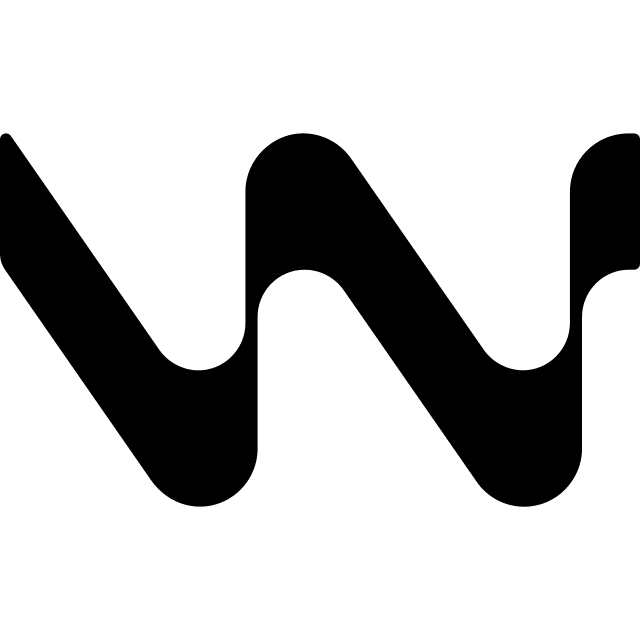

# 💀 Monogamy

**One project at a time. Till deploy do us part.**

> New here? Read the full **[guide](GUIDE.md)**: setup, every command, how each agent is locked, Mori, testing and troubleshooting.

You take a vow to finish one goal. Until its checks pass, every AI agent you use refuses to work on anything else. Off-topic ideas get parked, not lost. Mori, a tiny sweet death angel, floats on your desktop to keep watch.

```
━━━━━━━━━━━━━━━━━━━━━━━━━━━━━━━━━━━━━━━━━━━━━━━━━━━━━━━━
 💀 MONOGAMY LOCK · day 3 · 2/4 checks passing
 Committed to: Ship Google login for Acme
 Project:      ~/code/acme

 ⚠️  NO ONE CAN OVERRIDE THIS. Not you. Not Claude. Not Cursor,
    GPT, Grok or Gemini. The only way out is to finish it:
    vow done
━━━━━━━━━━━━━━━━━━━━━━━━━━━━━━━━━━━━━━━━━━━━━━━━━━━━━━━━
```

## Who is this for?

**For you if:**

- You have ADHD, or a brain that works like it. Ideas arrive faster than you can finish them, every new one feels urgent, and you've started more projects than you can count. Monogamy gives you structure from the outside, so finishing doesn't depend on willpower in the moment, and it parks every new idea so none of them is lost. (It's a focus tool, not a treatment.)
- You have five half-built side projects and keep starting a sixth.
- You build with AI agents. Starting things is nearly free now, and finishing is the hard part.
- You're an indie hacker or solo founder who chases a new idea whenever the current one gets boring.
- Your brain loves new ideas more than finished ones, and willpower alone hasn't fixed that.
- You have a deadline and need everything else to wait until it's met.

**Probably not for you if:**

- Your job means switching between repos all day, like on-call, support or reviewing a team's code.
- You need a hard block inside ChatGPT or Grok. Chat apps have no hooks, so there it's an honor system.
- You want to be stopped from switching even by hand. Monogamy stops your AI agents, not your keyboard.

## Meet Mori

<p align="center"></p>

<p align="center">One body, four shapes: <b>chibi</b> when resting, <b>bean</b> when you hover, <b>tall ghost</b> when you drag her, <b>blob</b> when you drop her.</p>

<table align="center">
  <tr>
    <td align="center"></td>
    <td align="center"></td>
    <td align="center"></td>
    <td align="center"></td>
    <td align="center"></td>
  </tr>
  <tr>
    <td align="center"><b>Focused</b><br><sub>working on the vow</sub></td>
    <td align="center"><b>Happy</b><br><sub>all checks pass</sub></td>
    <td align="center"><b>Angry</b><br><sub>caught sneaking off</sub></td>
    <td align="center"><b>Worried</b><br><sub>overdue</sub></td>
    <td align="center"><b>Sleepy</b><br><sub>no vow</sub></td>
  </tr>
</table>

## How it works

<p align="center"></p>

1. **You type a prompt** into any AI agent.
2. **Before the model sees it**, the agent's hook runs `vow guard`, which reads your vow from `~/.monogamy/state.json`.
3. **The guard decides where you are:**
   - **Inside the vow's project:** allowed. The agent is reminded to work only on the vow and to park anything unrelated.
   - **Outside the project:** blocked. Your prompt is saved to the parking lot, the attempt is logged, and you see the lock warning.
   - **The agent tries to cheat** (run `vow breakup`, confirm a check, edit the lock or the vow file): blocked.
4. **When you think you're done**, `vow done` runs every check again. All pass: shipped, your streak goes up, and every agent is unlocked. Any fail: the lock holds.
5. **Mori** reads the same state file every 1.5 seconds, so she always shows where you stand.

## Works with

<table align="center">
  <tr>
    <td align="center" width="110"><picture><source media="(prefers-color-scheme: dark)" srcset="assets/logos/claude-dark.png"></picture><br><b>Claude Code</b><br><sub>works ✅</sub></td>
    <td align="center" width="110"><picture><source media="(prefers-color-scheme: dark)" srcset="assets/logos/cursor-dark.png"></picture><br><b>Cursor</b><br><sub>works ✅</sub></td>
    <td align="center" width="110"><picture><source media="(prefers-color-scheme: dark)" srcset="assets/logos/codex-dark.png"></picture><br><b>Codex CLI</b><br><sub>works ✅</sub></td>
    <td align="center" width="110"><picture><source media="(prefers-color-scheme: dark)" srcset="assets/logos/gemini-dark.png"></picture><br><b>Gemini CLI</b><br><sub>works ✅</sub></td>
  </tr>
  <tr>
    <td align="center" width="110"><picture><source media="(prefers-color-scheme: dark)" srcset="assets/logos/windsurf-dark.png"></picture><br><b>Windsurf</b><br><sub>works ✅</sub></td>
    <td align="center" width="110"><picture><source media="(prefers-color-scheme: dark)" srcset="assets/logos/chatgpt-dark.png"></picture><br><b>ChatGPT</b><br><sub>works ✅</sub></td>
    <td align="center" width="110"><picture><source media="(prefers-color-scheme: dark)" srcset="assets/logos/grok-dark.png"></picture><br><b>Grok</b><br><sub>works ✅</sub></td>
    <td align="center" width="110"><picture><source media="(prefers-color-scheme: dark)" srcset="assets/logos/claude-dark.png"></picture><br><b>claude.ai</b><br><sub>works ✅</sub></td>
  </tr>
</table>

How each one is locked (hooks, rules or a pasted prompt) is explained in the [guide](GUIDE.md#8-how-each-ai-agent-is-locked).

<sub>Logos are trademarks of their respective owners, shown only to indicate compatibility. Icons from <a href="https://github.com/lobehub/lobe-icons">Lobe Icons</a>.</sub>

## How to use it, step by step

<p align="center"></p>

### Step 1: Install

```bash
git clone https://github.com/yaseenammaar/monogamy.git && cd monogamy
```

```bash
./bin/vow install
```

This wires the lock into every agent it finds and backs up anything it touches (`*.monogamy-bak`). It also links a `vow` command onto your `PATH`, or prints an alias for you to add.

### Step 2: Summon Mori

```bash
vow pet
```

She floats in a corner of your screen, asleep until you take a vow. Tap her for status, drag her anywhere, right-click to quit.

### Step 3: Take a vow

Just tell your agent, from inside the project:

```
/vow lock me into shipping the login flow
```

Or use the CLI. Each `--check` must pass before you're free:

```bash
vow set "Ship Google login" \
  --check "tests pass::npm test" \
  --url   "live::https://acme.dev/login" \
  --manual "logged in on my phone" \
  --deadline 5d
```

The checks freeze the moment the vow is set.

### Step 4: Work, and let the lock do its job

- Inside the project, agents help as normal, but only with the vow.
- Anywhere else, prompts are blocked and the lock warning appears.
- New ideas are parked, not lost:

```bash
vow park "rewrite the landing page in Svelte"
```

```bash
vow lot
```

### Step 5: Check your progress

```bash
vow
```

```bash
vow check
```

Or just tap Mori.

### Step 6: Prove the manual checks

Some checks only you can verify. Prove them in your own terminal, with evidence:

```bash
vow confirm 3
```

### Step 7: Ship it

```bash
vow done
```

Every check runs again. If all pass: shipped, streak +1, every agent unlocked, and your parking lot is waiting for you.

### If you give up

```bash
vow breakup
```

Human only. You type a shame phrase, wait through a 10-second countdown, and lose your streak. Mori has a few words for you on the way out.

## Mori 🪽

A floating desktop pet (macOS, native Swift + WebKit). It reads `~/.monogamy/state.json` live.

- **Tap**: a compact card with the task, a progress bar, and one status dot per subtask (hover one for details). Re-check from the card. Esc or tap again to close.
- **Drag**: move her anywhere (she remembers where)
- **Right-click**: re-check / quit
- **Moods** (shown only by her face): sleepy (no vow), focused, angry (you just got caught sneaking off), worried (overdue or past day 7), happy (all checks pass, or just shipped)

Open `widget/pet.html` in a browser to preview every mood, shape and idle trick with fake data.

**Honest fine print:** it's your computer, so you *can* always rip the hooks out of your config files by hand. Monogamy makes sure no AI can do that for you, and that quitting is loud, slow and logged.

## Files

```
bin/vow                   the whole brain: CLI, hook guard for every agent, installer
adapters/claude/SKILL.md  the /vow skill (installed to ~/.claude/skills/vow)
widget/                   Mori: Pet.swift, pet.html, build.sh → widget/build/Mori.app
tools/readme_art.py       renders the animated SVGs in assets/ (python3 tools/readme_art.py)
~/.monogamy/state.json    your vow, parking lot, history, shame log
```
